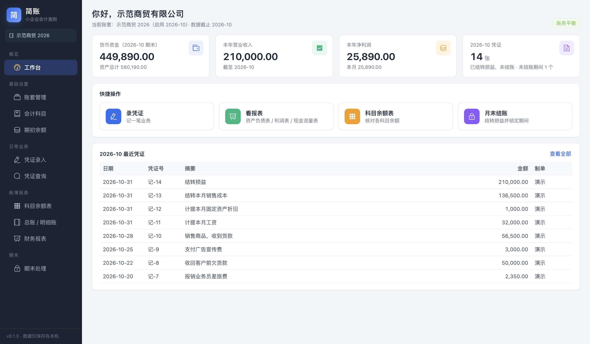
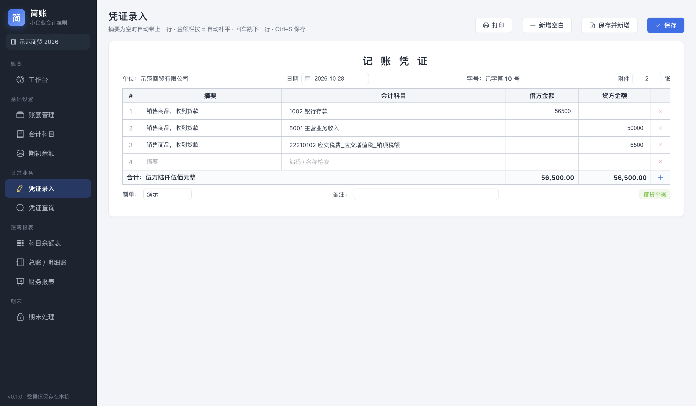
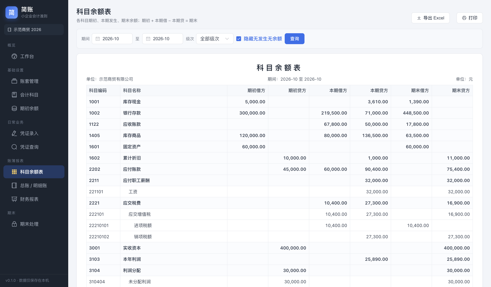
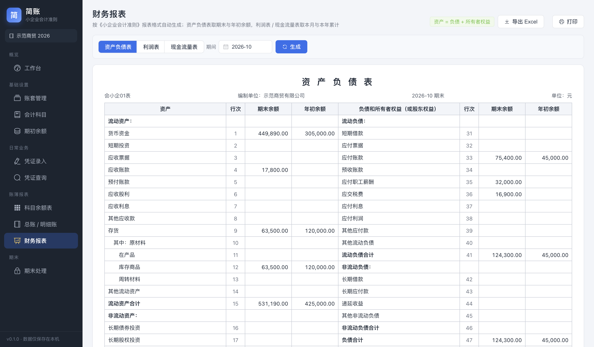

# 简账 —— 本地财务记账软件（小企业会计准则）

[](https://github.com/camzhou831-star/jizhang/actions/workflows/ci.yml)

> **Jizhang** is an offline desktop bookkeeping app for small businesses in China (Accounting Standards for Small Enterprises).
> Enter vouchers and get the trial balance, general ledger, balance sheet, income statement and cash-flow statement automatically.
> No server, no database to install: each set of books is a single SQLite file. Built with Electron, Vue 3 and sql.js. MIT licensed.

离线单机、免数据库、双击安装即用的财务记账软件：录入记账凭证 → 自动生成科目余额表 / 总账 / 明细账 / 资产负债表 / 利润表 / 现金流量表。

## 界面
以下截图使用虚构的演示账套「示范商贸有限公司」。

| 工作台 | 凭证录入 |
| :---: | :---: |
|  |  |
| **科目余额表** | **资产负债表** |
|  |  |

## 下载
去 [Releases](https://github.com/camzhou831-star/jizhang/releases) 下载：
- `jizhang-setup-x.y.z.exe` —— Windows 安装包（推荐）
- `jizhang-portable-x.y.z.exe` —— 免安装版，双击直接运行

## 功能
- **工作台**：货币资金、本年收入/净利润、本期凭证数一眼看全，快捷入口
- **账套管理**：多账套、一键备份为单个 `.db` 文件、导入别人发来的账套文件
- **会计科目**：预置《小企业会计准则》66 个一级科目 + 常用明细（应交增值税进/销项、管理费用明细等），可自行增加明细科目（4-2-2-2 编码）
- **期初余额**：末级科目录入，实时试算平衡；年中启用可录本年累计
- **凭证录入**：自动编号、摘要联想、科目编码/名称检索、`=` 自动补平、回车跳行、借贷平衡校验、大写金额、打印
- **凭证查询**：按期间/关键字查询、编辑、删除、整理断号、导出 Excel
- **账簿**：科目余额表（可选级次）、总账、明细账（双击跳凭证）
- **报表**：资产负债表（会小企01表）、利润表（会小企02表）、现金流量表（会小企03表，按对方科目自动归类）；导出 Excel / 打印
- **期末处理**：一键结转损益（自动生成凭证）、结账 / 反结账（结账后期间锁定）

## 数据存放
- Windows：`%APPDATA%\简账\books\*.db`（账套页右上「打开账套存放目录」）
- 每个账套一个 SQLite 文件，复制即备份；「导入账套文件」即可在另一台电脑打开

## 开发
```bash
pnpm install        # 首次
pnpm dev            # 开发模式
pnpm test           # 记账引擎单元测试（试算/三表/结转/结账）
pnpm typecheck
pnpm build:win      # 产出 release/jizhang-setup-x.y.z.exe 与 jizhang-portable-x.y.z.exe
pnpm build:mac      # 产出 dmg
```
技术栈：Electron 33 + Vue 3 + Element Plus + sql.js（纯 WASM SQLite，无原生依赖，可在 Mac 上直接交叉打 Windows 包）。

## 目录
```
src/shared/coa.ts            预置科目表
src/main/db.ts               SQLite 封装 / 表结构
src/main/services/           accounts 科目 · vouchers 凭证 · ledger 账簿引擎 · reports 三表 · closing 期末
src/renderer/src/views/      各页面
test/engine.test.ts          引擎测试
```

## 许可
[MIT](LICENSE)
